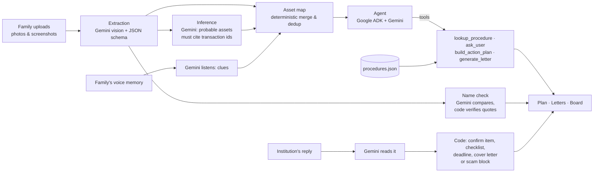

# Virasat: find and claim what your loved one left behind

> *Virasat* (विरासत) means "legacy" in Hindi: the legacy your loved one left.

When someone dies in India, their family often doesn't know what accounts, policies or investments existed. Money
sits unclaimed because nobody knew to ask. Virasat helps a grieving family find those assets and claim them.

The family uploads whatever they have: photos of bank statements, a passbook, SMS and UPI screenshots, a premium
receipt. Virasat then:

1. **Reads** each document with Gemini and pulls out accounts, policies, balances, nominees and transactions.
2. **Finds what's missing.** It spots assets that probably exist but weren't uploaded. Dividend credits imply a demat
   account; a monthly NACH debit to an insurer implies a policy nobody has found yet.
3. **Builds a plan** for each institution: what to do first, which documents to carry, and in what order.
4. **Drafts the letters**: claim intimations for known assets, and polite "please confirm" enquiries for probable ones.
5. **Listens to what the family remembers.** A widow can say, in Hindi, *"he paid an insurance premium every month"*.
   Gemini turns the recording into clues; code checks them against the statements. Memory plus matching payments
   raises confidence; a memory alone becomes a low-confidence lead with an enquiry letter, never a fact.
6. **Catches name mismatches before they stall a claim.** "Suresh Narayan Rao" on the bank statement, "S N RAO" on
   the EPF passbook: Gemini spots the variants, code checks every quoted name, and the knowledge base says what to do.
7. **Reads the institution's reply and closes the loop.** Upload the insurer's letter: the probable policy becomes
   confirmed, the documents they want become a checklist with a respond-by date, and a covering letter is drafted.
   A reply asking for a fee, an OTP or a UPI payment is flagged as a scam and changes nothing.

Everything works in **English and Hindi**, in warm, simple language, with a one-tap read-aloud option.

Built for the **Google Cloud AI Builder Cup**.

**Live demo:** _add the Cloud Run URL here after deploying_.

---

## The 3-minute demo

A fully synthetic family is built in: the late Mr. Suresh Narayan Rao, with 9 watermarked documents from
fictional banks and insurers ([demo/README.md](demo/README.md) lists everything planted). The app no longer offers it
on the start screen; the scripts and tests use it (`POST /api/demo`, `scripts/run_demo_case.py`), and its documents in
`demo/docs/` can be uploaded like any others (they are then read live by Gemini).

- **Confirmed from documents:** two savings accounts, an FD, a life policy, a mutual fund folio, EPF and a home loan.
  Overlapping documents (two statement pages, a UPI screenshot of the same payments) are de-duplicated.
- **Found with no document at all:** a demat account at "Anand Stockbroking" (from dividend credits and DP charges)
  and a second life policy with "Kavach Life" (from monthly premium debits). Both are shown as **probable**, with
  the exact transactions as evidence. They are never presented as facts.
- **Gaps flagged:** the EPF passbook shows no nominee, so Virasat asks the family a follow-up question.
- **Kamala remembers (in Hindi):** on *What we found*, "Use this recording" plays a 15-second synthetic voice memo. The
  Kavach premiums she remembers match three statement debits; the PPF account at the post office she mentions has no
  paper at all, so it is added as *not very sure*, with an enquiry letter.
- **Names differ:** on *Plan*, the EPF passbook says "S N RAO" and the co-op passbook's nominee is "Smt. Kamla Rao".
- **Replies:** on the Kavach task, "Try the sample reply" uploads the insurer's letter: the policy the app had only
  inferred is now confirmed (₹15,00,000, nominee on record), with 5 documents to send by 5 Nov and a covering letter.
  On the bank's task, "Try a sample scam message" shows a fee-and-OTP message being blocked.

---

## How it works



| Step | Who does it | Where |
|---|---|---|
| Read documents | Gemini (`EXTRACTION_MODEL`), image in, Pydantic-validated JSON out | [backend/tools/extraction.py](backend/tools/extraction.py) |
| Confirmed assets | **Deterministic code**: merge by masked identifier, dedup across documents | [backend/tools/asset_map.py](backend/tools/asset_map.py) |
| Probable assets | Gemini (`REASONING_MODEL`); every claim must cite real transaction ids; code discards any proposal without valid evidence | [backend/tools/inference.py](backend/tools/inference.py) |
| Orchestration | Agent built on Google ADK (Agent Development Kit) over Gemini, max 10 model calls, every step written to an activity log (en + hi) | [backend/agent/](backend/agent/) |
| Procedures | Looked up only from a knowledge base, each with a `source_name` | [backend/kb/procedures.json](backend/kb/procedures.json) |
| Plan, letters, PDFs | **Deterministic code** | [backend/tools/plan.py](backend/tools/plan.py), [backend/tools/letters.py](backend/tools/letters.py) |
| Totals, dates, masking, ID checks | **Deterministic code**, never the model | [backend/tools/finance.py](backend/tools/finance.py) |
| Family memories | Gemini listens to the recording (or reads typed text) and lists clues; **code** matches them to transactions and sets confidence from the evidence (memory alone = low) | [backend/tools/memories.py](backend/tools/memories.py) |
| Name check | Gemini compares how names are written; **code** drops any finding whose quoted name isn't on the cited document; guidance from the knowledge base | [backend/tools/names.py](backend/tools/names.py) |
| Institution replies | Gemini reads the letter; **code** checks for scam signals, confirms the item, works out the respond-by date, moves the task and drafts the covering letter | [backend/tools/replies.py](backend/tools/replies.py) |

All AI goes through one place, [backend/app/gemini.py](backend/app/gemini.py), using the official `google-genai`
SDK with `response_json_schema`. It throttles requests per model and honours 429 retry delays. If a call fails or a
reply doesn't validate, the error is shown. Virasat never substitutes made-up data.

## Guardrails

These run **in code**, not just in prompts:

- **Probable is never presented as fact.** Inferred items are always `probable`, carry evidence and a confidence
  level, are left out of totals, and get an "enquiry" letter rather than a claim letter.
- **No credentials.** Any request to use the deceased's cards, PINs, OTPs, passwords or net banking is refused
  *before* any model call ([backend/agent/guardrails.py](backend/agent/guardrails.py)), in English and Hindi.
- **Guidance, not legal advice.** Wills, succession and legal-heir topics automatically get that note.
- **Procedures are cited.** Steps come only from the knowledge base. If nothing matches, Virasat says "please confirm
  with the institution".
- **Masking.** Only the last 4 digits of any account or policy number are shown or stored on asset items.
- **Privacy.** On Cloud Storage, uploads delete themselves after 24 hours (bucket lifecycle rule). The family can
  delete the whole case at any time.
- **A case opens only on the device that started it.** The creating browser gets a random private key (an HttpOnly,
  SameSite=strict cookie scoped to that case's API routes); only its SHA-256 hash is stored. A forwarded link alone
  gets the same 404 as a missing case. There is no share link: nothing about a case can be opened by anyone else.
- **Memories and replies are never facts by themselves.** A memory with no matching payment is a low-confidence
  probable item. A number heard in a recording is never used as an account number. Secrets said aloud (PINs,
  passwords, card numbers) are removed in code before anything is stored, and recordings and reply letters are read
  once and not kept.
- **Scam replies change nothing.** A reply is checked in code for fee requests, OTP/PIN/password requests, remote-access
  apps and payments to UPI ids or QR codes, on top of Gemini's own red flags. Any flag blocks every change: no item is
  confirmed, no task moves, no letter is drafted, and the family sees a plain warning with the sender's own words.
- **Scam protection.** A money-after-death alert puts an account first in the plan when debits continue after the
  death; documents in someone else's name are flagged; every letter asks the institution to verify the sender
  against its nominee records; Plan and Letters warn that banks never ask for OTPs or fees.

## Screens

Start → **Upload** → **Asset map** → **Questions** → **Plan** → **Letters** → **Board** (track each step) ·
**Privacy**. Each screen has one primary action, an 18px base font, and an English/Hindi toggle.

---

## Run it locally

Needs Python 3.11+ and Node 22+.

```bash
python3 -m venv .venv && .venv/bin/pip install -r backend/requirements-dev.txt
cp .env.example .env               # then add your GEMINI_API_KEY (https://aistudio.google.com/apikey)

(cd frontend && npm install && npm run build)                 # build the UI into frontend/dist
.venv/bin/uvicorn app.main:app --app-dir backend --reload     # open http://localhost:8000
```

For UI development, run `(cd frontend && npm run dev)` as well (port 5173, proxies `/api` to port 8000).

### Configuration (`.env`)

| Variable | Default | Notes |
|---|---|---|
| `GEMINI_API_KEY` | none | Required for live Gemini calls |
| `EXTRACTION_MODEL` | `gemini-3.8-flash` | Reads document images |
| `REASONING_MODEL` | `gemini-4-argon` | Inference + agent. **Not on the free tier**; `.env.example` uses `gemini-3.6-flash` |
| `GEMINI_RPM` | `0` | Client-side requests/minute per model. Use `5` on the free tier |
| `GEMINI_DAILY_LIMIT` | `300` | Gemini calls per day per instance (about 30 analyses); then a polite "try tomorrow". `0` = no limit. Also set a quota on the key in the Cloud Console |
| `STORAGE_BACKEND` | `local` | `local` = JSON files on disk; `gcp` = Firestore + Cloud Storage |
| `LOCAL_DATA_DIR` | `./data` | For `local` storage |
| `GCP_PROJECT`, `GCS_BUCKET`, `FIRESTORE_DATABASE` | none | For `gcp` storage |
| `DEMO_REPLAY_EXTRACTION` | `true` | Sample-family uploads replay recorded Gemini readings (see below) |

**On the free tier** (about 5 requests/minute and 20/day per model), use two *different* free models for
extraction and reasoning so each gets its own daily quota. Note that Google may use free-tier API data to improve
its products, which is fine for the synthetic demo but not for real families' documents.

**Saved readings.** For the sample family only, extraction replays the *real* Gemini replies recorded in
[demo/recorded/](demo/recorded/) for byte-identical demo documents. This saves quota and keeps the demo
predictable. It is labelled "sample reading" in the activity log. Real uploads are always read live.

### Useful scripts

```bash
.venv/bin/python scripts/run_demo_case.py --replay   # recorded extraction + live inference; exits 1 unless both
                                                     # planted assets are found
.venv/bin/python scripts/run_agent_demo.py           # live agent: activity log, plan, a letter (--hi for Hindi)
.venv/bin/python scripts/run_extraction.py           # live extraction on the demo docs
.venv/bin/python scripts/run_extraction.py --record --missing   # record replies for docs without a fixture
.venv/bin/python scripts/make_demo_docs.py           # regenerate the synthetic demo images, samples and voice memo
.venv/bin/python scripts/record_samples.py --record  # record real Gemini replies for the voice memo, the two sample
                                                     # replies and the name check (replayed for the demo family)
```

## Tests

```bash
.venv/bin/pytest backend
```

Tests **never call the live Gemini API**. They use real Gemini replies recorded in [demo/recorded/](demo/recorded/)
or a fake client. The Firestore/Cloud Storage tests are skipped unless the emulators are running (see the docstring
in [backend/tests/test_gcp_storage.py](backend/tests/test_gcp_storage.py)).

## Deploy to Google Cloud Run

One container: a multi-stage [Dockerfile](Dockerfile) builds the React frontend, and FastAPI serves it alongside the
API.

```bash
# try the container locally
docker build -t virasat . && docker run -p 8080:8080 -e STORAGE_BACKEND=local -e LOCAL_DATA_DIR=/tmp/data \
  -e GEMINI_API_KEY=... virasat

# deploy (after: gcloud auth login && gcloud config set project YOUR_PROJECT_ID)
GEMINI_API_KEY=... ./scripts/deploy.sh
```

[scripts/deploy.sh](scripts/deploy.sh) is safe to re-run. It enables the APIs, creates the Firestore database, the
upload bucket (with the 24-hour delete rule), a runtime service account and a Secret Manager secret for the key,
then deploys to `asia-south1` (Mumbai) with `min-instances=1` to avoid cold starts. It defaults to a billed key
(`gemini-4-argon`, no throttle). To test on the free tier, run
`REASONING_MODEL=gemini-3.6-flash GEMINI_RPM=5 MAX_INSTANCES=1 ./scripts/deploy.sh`; free-tier data may be used by
Google to improve its products, so use it only with the synthetic demo family.

## Tech stack

**Google Gemini** (`google-genai` SDK) · **Python / FastAPI / Pydantic v2** · **React + Vite + Tailwind v4** ·
**Cloud Run** · **Firestore** · **Cloud Storage** · **Secret Manager** · fpdf2 for letter PDFs · pytest

## Repository layout

```
backend/
  app/        FastAPI app, config, Pydantic models (the API contract and Gemini schemas), Gemini client, services
  tools/      extraction, inference, asset map, plan, letters, questions, deterministic finance helpers
  agent/      ADK agent, tool definitions, guardrails
  kb/         procedures.json knowledge base
  storage/    storage interface with local (JSON) and GCP (Firestore + GCS) backends
  tests/      pytest, no network
frontend/     React + Vite + Tailwind UI
scripts/      demo generation, live runs, Cloud Run deploy
demo/         synthetic demo documents, recorded Gemini replies, list of what is planted
```

## Limitations and honesty notes

- **All demo data is synthetic.** Every person and institution is fictional, and every image is watermarked
  "SYNTHETIC DEMO DOCUMENT".
- **Procedures are placeholders.** Entries in `procedures.json` are marked `verified: false`, and the app says so
  and asks families to confirm with each institution.
- **Out of scope:** real bank or insurer integrations, payments, e-signing and legal filings. Virasat prepares the
  family to act; it doesn't act for them.

*Virasat gives guidance, not legal or financial advice.*
